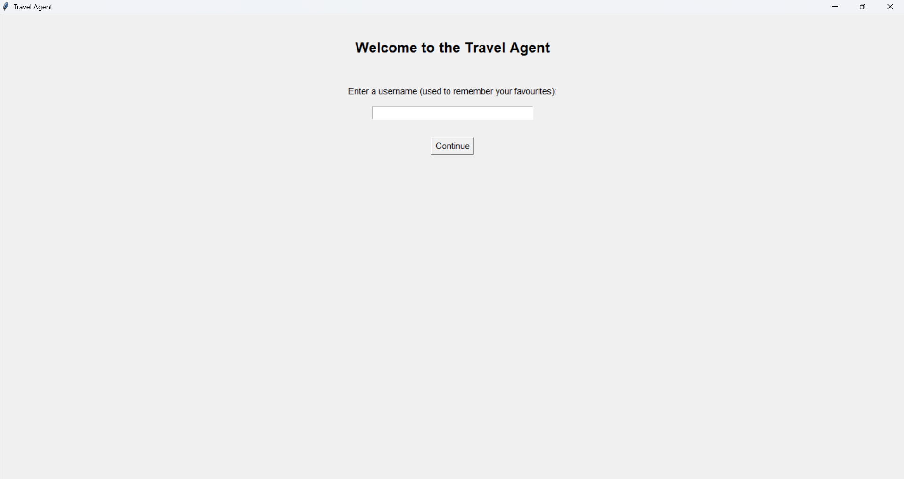
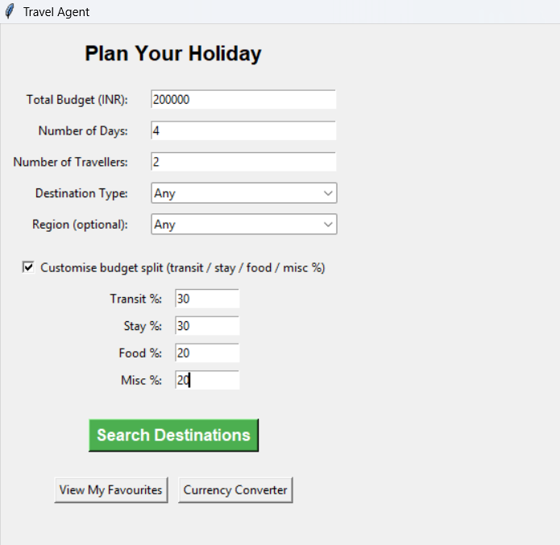
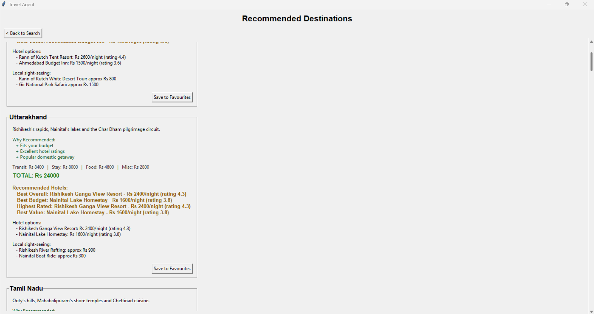
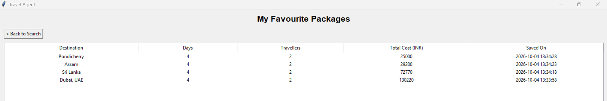
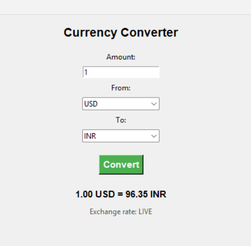

# Travel Agent

A Python/Tkinter travel planning application that uses MySQL to recommend destinations based on a user's budget, trip length, number of travellers, destination type, region, and optional custom budget split. It also provides hotel recommendations, sightseeing information, favourites, and a multi-currency converter.

> **Project type:** Student Python desktop application  
> **GUI:** Tkinter  
> **Database:** MySQL  
> **Exchange rates:** Free public API with offline fallback

## Features

- Username-based user system for saving favourites
- Destination search using total budget, days, and number of travellers
- Domestic/international and regional filtering
- Customisable budget allocation across transit, accommodation, food, and miscellaneous costs
- Destination results sorted from cheapest to most expensive
- Hotel and sightseeing information for matching destinations
- Rule-based “Why Recommended” explanations
- Hotel badges for Best Overall, Best Budget, Highest Rated, and Best Value
- Save and remove complete travel packages from favourites
- Currency conversion between USD, INR, EUR, GBP, and JPY
- Live exchange rates when the API is available, with offline fallback rates when it is not

The recommendation system is **not AI/ML**. Destination and hotel recommendations are deterministic, explainable rules and calculations.

## Application Screenshots

The project was provided without output screenshots, so placeholders are included below. Replace the placeholder image files in `assets/screenshots/` with your own screenshots.

### Login

> **Screenshot placeholder:** Add `assets/screenshots/login.png` here.



### Search / Holiday Planning

> **Screenshot placeholder:** Add `assets/screenshots/search.png` here.



### Recommended Destinations

> **Screenshot placeholder:** Add `assets/screenshots/results.png` here.



### Favourites

> **Screenshot placeholder:** Add `assets/screenshots/favourites.png` here.



### Currency Converter

> **Screenshot placeholder:** Add `assets/screenshots/currency-converter.png` here.



## Project Structure

```text
travel-agent-app/
├── api_utils.py
├── config.py
├── core_logic.py
├── db_setup_fixed.py
├── Main.py
├── requirements.txt
├── .gitignore
├── assets/
│   └── screenshots/
│       └── README.md
└── README.md
```

### `Main.py`

The main entry point and Tkinter GUI. It manages the Login, Search, Results, Favourites, and Currency Converter interfaces.

### `core_logic.py`

Contains the application's business logic, including MySQL operations, budget calculations, destination searching, recommendation rules, hotel scoring, and favourites.

### `db_setup_fixed.py`

Creates and resets the `travel_agent_db` database, recreates its tables, and inserts the sample destinations, hotels, and sightseeing data.

**Important:** running this script resets the database and deletes previously stored users and favourites.

### `config.py`

Stores the MySQL connection settings and default budget split in one place.

### `api_utils.py`

Handles exchange-rate retrieval and currency conversion. It uses a free public API and falls back to fixed rates if the API or internet connection is unavailable.

## Database Design

The application uses the `travel_agent_db` MySQL database with five main tables:

- `users` — usernames used to associate favourites with a user
- `destinations` — destination details and estimated travel costs
- `hotels` — hotels associated with destinations, including prices and ratings
- `local_spots` — sightseeing spots and approximate local costs
- `favourites` — saved travel packages linked to users and destinations

Foreign-key relationships use cascading deletes where appropriate.

## How Recommendations Work

The application first divides the user's budget into four categories. The default split is:

| Category | Default allocation |
|---|---:|
| Transit | 30% |
| Stay | 40% |
| Food | 20% |
| Miscellaneous | 10% |

Users can customise these percentages, provided that all four values are supplied and add up to 100%.

For each destination, the application estimates:

- **Transit:** cost per person × travellers
- **Stay:** nightly room cost × days × rooms required
- **Food:** daily food cost × days × travellers
- **Miscellaneous:** daily miscellaneous cost × days × travellers

The application assumes **two travellers per room** and rounds up when more rooms are needed.

A destination is recommended only when **all four individual category costs** fit within their corresponding budget allocations. Matching destinations are then sorted by total estimated cost.

The “Why Recommended” section uses simple rules such as budget fit, average hotel rating, and domestic/international destination type. Hotel badges use explicit mathematical scoring rather than AI.

## Currency Converter

The standalone Currency Converter supports:

- USD
- INR
- EUR
- GBP
- JPY

It attempts to retrieve live exchange rates from the public ExchangeRate-API endpoint. If the request fails, the application uses built-in fallback rates so the converter can continue working offline.

Normal destination search does not depend on live currency conversion because the current sample destination prices are already stored in INR.

## Setup

### 1. Install Python

Use a recent Python 3 installation with Tkinter available.

### 2. Install the MySQL connector

From the project directory:

```bash
pip install -r requirements.txt
```

### 3. Install and start MySQL

Make sure a local MySQL server is running before starting the application.

### 4. Configure MySQL credentials

Open `config.py` and replace the placeholders with your local MySQL username and password:

```python
DB_CONFIG = {
    "host": "localhost",
    "user": "your_mysql_username_here",
    "password": "your_mysql_password_here",
    "database": "travel_agent_db"
}
```

Do not commit real passwords to GitHub.

### 5. Create and seed the database

Run:

```bash
python db_setup_fixed.py
```

This creates the database if necessary, drops existing tables, recreates them, and inserts the sample data.

**Warning:** running this command again resets the database, including saved users and favourites.

### 6. Start the application

Run:

```bash
python Main.py
```

## Typical User Flow

```text
Start application
      ↓
Enter username
      ↓
Enter budget, days and travellers
      ↓
Optionally choose destination type / region
      ↓
Optionally customise budget split
      ↓
Search destinations
      ↓
Calculate costs and check all four budget categories
      ↓
Display matching destinations
      ↓
View hotels and sightseeing spots
      ↓
Save a package to favourites (optional)
      ↓
View or remove saved packages
```

The Currency Converter can be opened from the Search screen at any time.

## Architecture

The project separates presentation, business logic, configuration, API operations, and database setup:

```text
Main.py
  │
  ├── GUI and user interaction
  │
  └── calls core_logic.py
          │
          ├── MySQL operations
          ├── budget calculations
          ├── destination search
          ├── recommendation rules
          └── favourites

api_utils.py ── currency/API operations

config.py ───── MySQL configuration + default budget split

db_setup_fixed.py ── database creation/reset + sample data
```

This separation keeps the GUI code independent from most of the application's database and calculation logic.

## Limitations

- Destination, hotel, and sightseeing prices are approximate sample estimates rather than live booking prices.
- The login system uses usernames only; there is no password-based authentication.
- Travel costs are based on a simplified cost model rather than real-time flight, hotel, or booking availability.
- Hotel recommendations use fixed mathematical formulas and do not learn from user preferences.
- Currency conversion depends on the public exchange-rate API for live rates, although fallback rates are available offline.
- The database setup script resets stored application data whenever it is run.

## Future Improvements

- **Real booking and pricing integration:** connect the planner to travel, hotel, and activity APIs so users can work with current availability and prices instead of sample estimates.
- **Secure authentication:** add password-based or another proper authentication system so user accounts are protected rather than identified only by username.
- **Richer personalisation:** allow users to specify interests such as beaches, mountains, culture, adventure, or relaxation and use those preferences when ranking destinations.
- **More flexible trip planning:** allow users to adjust the assumptions for rooms, food, local transport, and other expenses instead of relying on the current fixed cost model.
- **Improved interface:** redesign the Tkinter screens with a more modern layout, clearer visual hierarchy, destination images, and more polished result cards.
- **Persistent favourites without reset:** separate database setup/migration from seeding so normal database maintenance does not delete existing users and favourites.

## Technologies

- Python
- Tkinter / `ttk`
- MySQL
- `mysql-connector-python`
- `urllib.request`
- JSON
- Exchange-rate API

## Notes for GitHub

The repository intentionally does not include MySQL credentials. Configure `config.py` locally before running the application.

The screenshot files are also intentionally absent because this project was provided without output screenshots. Add your own screenshots to `assets/screenshots/` using the filenames described above.
